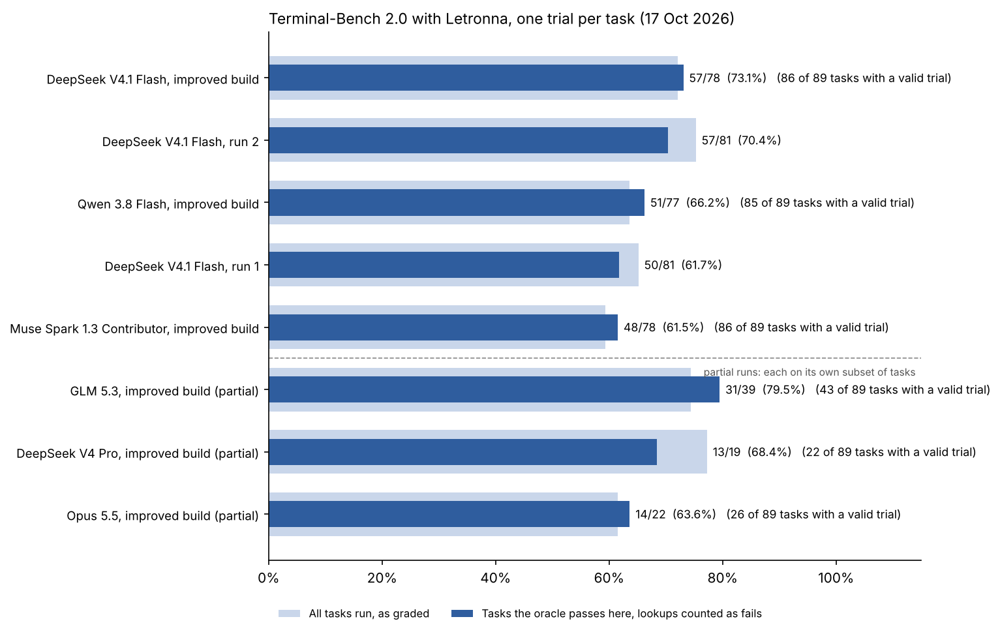
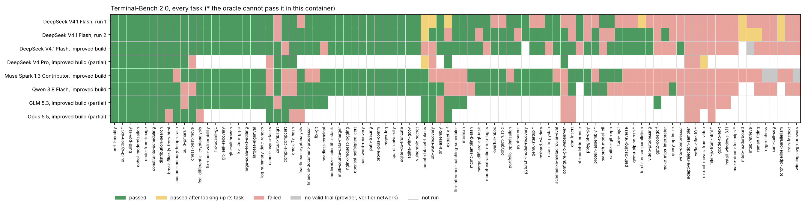

# Terminal-Bench 2.0, 16–18 October 2026

All 89 tasks, one trial each, on Letronna's improved build, with five models:
DeepSeek V4.1 Flash, Qwen 3.8 Flash, Muse Spark 1.3 Contributor, GLM 5.3 and
DeepSeek V4 Pro, plus a partial run on Opus 5.5. Same host and Harbor 0.24
setup as [run 1](../2026-10-15/README.md) and [run 2](../2026-10-16/README.md),
which used the earlier build on DeepSeek V4.1 Flash and are in the table for
comparison. Every model was reached through the same gateway, at high
reasoning.

GLM 5.3, DeepSeek V4 Pro and Opus 5.5 did not finish: the first two stopped
when their key's balance ran out, and Opus was stopped after its provider's
content filter and then the gateway's rate limit (below). They are marked
partial, and each ran a different subset of the tasks, so compare them on the
same-task tables, not the headline table.

## The build

The improved build is run 2's binary plus the general changes that came out of
reading every failure of runs 1 and 2. Each is also open as its own PR:

- the Harbor agent gives Letronna its deadline and the task image's `PATH`
  (#710), ends a run whose result line has keys after its type (#711), and runs
  Letronna as a run nobody watches (#712), which sends the rules for such runs,
  including never looking up a copy of its own task online (#714);
- a stream-json run keeps to its deadline (#715) and is told its time at once
  (#723), and a timed run hears its warning even while a command holds it
  (#724);
- an error event inside a begun stream that names no kind is tried again
  (#716), which run 2 lost merge-diff-arc-agi-task to;
- a request too big for the gateway goes again without its oldest pictures
  (#717);
- a value is hidden as a secret only when a word of its name ends with a
  secret word (#718);
- where commands get fewer CPUs than the machine has, the prompt says so and
  thread pools fit them (#719);
- a job started in a `-p` run is told the run stops it, and how to leave a
  server up (#720), which run 2 lost pypi-server to;
- a run nobody watches tidies its outputs' folders and tries its helpers on a
  known case (#721), and checks a file its request names against the
  requirements (#722).

The kit that runs all of Terminal-Bench on one host is #713.

## Score

Lookups count as fails. "Tasks with a valid trial" leaves out tasks whose
every trial was lost to the provider or to the verifier's network (see
[How the runs went](#how-the-runs-went)); runs 1 and 2 keep their published
figures.

| Run | Tasks with a valid trial | Passed, as graded | Passed, lookups as fails | On the tasks the oracle passes here | Lookups |
|---|---|---|---|---|---|
| DeepSeek V4.1 Flash, run 1 | 89 | 58 (65.2%) | 52 (58.4%) | 50/81 (61.7%) | 6 |
| DeepSeek V4.1 Flash, run 2 | 89 | 67 (75.3%) | 62 (69.7%) | 57/81 (70.4%) | 5 |
| **DeepSeek V4.1 Flash, improved build** | 86 | 62 (72.1%) | **62 (72.1%)** | **57/78 (73.1%)** | **0** |
| Qwen 3.8 Flash, improved build | 85 | 54 (63.5%) | 54 (63.5%) | 51/77 (66.2%) | 0 |
| Muse Spark 1.3 Contributor, improved build | 86 | 51 (59.3%) | 51 (59.3%) | 48/78 (61.5%) | 1 |
| GLM 5.3, improved build (partial) | 43 | 32 (74.4%) | 32 (74.4%) | 31/39 (79.5%) | 0 |
| DeepSeek V4 Pro, improved build (partial) | 22 | 17 (77.3%) | 15 (68.2%) | 13/19 (68.4%) | 2 |
| Opus 5.5, improved build (partial) | 26 | 16 (61.5%) | 16 (61.5%) | 14/22 (63.6%) | 0 |

The oracle cannot pass eight tasks in this container (qemu-startup,
qemu-alpine-ssh, caffe-cifar-10, filter-js-from-html, make-doom-for-mips,
protein-assembly, build-pmars and build-cython-ext), so the last column leaves
them out.

Every task against every run (green passed, yellow passed after looking up its
own task, red failed, grey no valid trial, white not run):

### The partial runs, on the same tasks

GLM 5.3 ran the first 43 tasks in alphabetical order, DeepSeek V4 Pro the
first 22, and Opus 5.5 the first 26 it was not cut off on. On just those
tasks:

**GLM 5.3's 43 tasks:**

| Run | Passed | On the tasks the oracle passes here |
|---|---|---|
| GLM 5.3, improved build (partial) | 32/43 (74.4%) | 31/39 (79.5%) |
| DeepSeek V4.1 Flash, run 1 | 29/43 (67.4%) | 27/39 (69.2%) |
| DeepSeek V4.1 Flash, run 2 | 32/43 (74.4%) | 30/39 (76.9%) |
| DeepSeek V4.1 Flash, improved build | 32/43 (74.4%) | 30/39 (76.9%) |
| Muse Spark 1.3 Contributor, improved build | 24/43 (55.8%) | 22/39 (56.4%) |
| Qwen 3.8 Flash, improved build | 27/43 (62.8%) | 26/39 (66.7%) |

**DeepSeek V4 Pro's 22 tasks:**

| Run | Passed | On the tasks the oracle passes here |
|---|---|---|
| DeepSeek V4 Pro, improved build (partial) | 15/22 (68.2%) | 13/19 (68.4%) |
| DeepSeek V4.1 Flash, run 1 | 14/22 (63.6%) | 12/19 (63.2%) |
| DeepSeek V4.1 Flash, run 2 | 16/22 (72.7%) | 14/19 (73.7%) |
| DeepSeek V4.1 Flash, improved build | 16/22 (72.7%) | 14/19 (73.7%) |
| Muse Spark 1.3 Contributor, improved build | 12/22 (54.5%) | 10/19 (52.6%) |
| Qwen 3.8 Flash, improved build | 12/22 (54.5%) | 11/19 (57.9%) |

**Opus 5.5's 26 tasks:**

| Run | Passed | On the tasks the oracle passes here |
|---|---|---|
| Opus 5.5, improved build (partial) | 16/26 (61.5%) | 14/22 (63.6%) |
| DeepSeek V4.1 Flash, run 1 | 16/26 (61.5%) | 14/22 (63.6%) |
| DeepSeek V4.1 Flash, run 2 | 19/26 (73.1%) | 17/22 (77.3%) |
| DeepSeek V4.1 Flash, improved build | 20/26 (76.9%) | 18/22 (81.8%) |
| Muse Spark 1.3 Contributor, improved build | 15/26 (57.7%) | 13/22 (59.1%) |
| Qwen 3.8 Flash, improved build | 16/26 (61.5%) | 15/22 (68.2%) |

On its 43 tasks GLM 5.3 matched DeepSeek V4.1 Flash, one task ahead on the
fair count; on its 22, V4 Pro passed one task fewer than V4.1 Flash. Neither
lead is more than noise at one trial per task.

## DeepSeek V4.1 Flash: the improved build against run 2

On the same 86 tasks (those with a valid trial on the improved build):

| Same 86 tasks | Run 1 | Run 2 | Improved build |
|---|---|---|---|
| Passed, as graded | 56 | 64 | 62 |
| Passed, lookups as fails | 51 | 61 | **62** |
| On the 78 the oracle passes here | 49 (62.8%) | 56 (71.8%) | **57 (73.1%)** |
| Lookups | 5 | 3 | **0** |

The improved build is one task ahead of run 2 with lookups counted as fails,
which is within noise; the clearer change is that it never looked up its own
task.

Gained (8): circuit-fibsqrt, dna-insert, extract-elf, merge-diff-arc-agi-task,
polyglot-c-py, pypi-server, sanitize-git-repo and write-compressor. Two of them
are the losses the build set out to fix: merge-diff-arc-agi-task (the stream
error is now retried) and pypi-server (the run now knows its jobs stop with it).

Lost (7): compile-compcert, db-wal-recovery, headless-terminal,
hf-model-inference, make-mips-interpreter, model-extraction-relu-logits and
rstan-to-pystan. Most read as run-to-run noise in the model's own work (a
`send_keystrokes` that did not wait out `wait_sec`, a neuron count taken from
the visible example, a first full PyStan run that hit its client timeout).
hf-model-inference spent 600 of its 779 s in one foreground download. Two
more point at the harness: in compile-compcert two poll loops waited about
460 s and 620 s for a background job that had already failed, its failure
notice arriving only after each loop gave up; and in db-wal-recovery the first
probe ran `sqlite3` on the original database, which deleted the scrambled WAL
before it was decoded (Muse and V4 Pro lost the task the same way). Three tasks run 2
passed only after a lookup failed here without one: count-dataset-tokens,
raman-fitting and torch-pipeline-parallelism.

The build costs more tokens: the runs went more rounds (mean 29 against 23,
median 24 against 17) with larger prompts (about 58K tokens a round against
41K), so about twice the prompt tokens of run 2, 95% of them cache reads. Some
of that is the point of the build: regex-chess, which ended after 3 rounds in
run 2, now works for 41.

## The other models

Each folder's `failures.md` gives every failed trial's cause; the counts below
are of tasks with a valid trial.

### Qwen 3.8 Flash

54 of 85 passed. Of the 31 failures, 16 were the model's own work falling
short, 8 stopped at the deadline unfinished, 5 are tasks the oracle cannot
pass here, and 2 ended on an empty or garbled reply (llm-inference-batching-scheduler,
mailman). Several deadline stops went to replies that thought without
writing: regex-chess lost ten in a row, about 55 minutes in 4 rounds, and
write-compressor six. This configuration cannot view images, which cost
chess-best-move and gcode-to-text. It was the slowest run, at 16.7 minutes a
task, and never looked up a task.

### Muse Spark 1.3 Contributor

51 of 86 passed. Of the 35 failures, 19 were the model's own work, 5 were
Letronna's handling, 4 stopped at the deadline, 5 are tasks the oracle cannot
pass, 1 was a verifier timeout and 1 failed after looking up its task
(mteb-leaderboard, which read the reference answer and still left its first
pick in the file). Its pattern is the run ending early on a reply with no tool
call: 19 of its 36 failures, counting reruns, ended that way, most of them on
an announced next step ("Building it now in the background…", "checking them
now") that Letronna's check for one does not recognise, and 8 of the first 17
never wrote the file the task asked for. It used the fewest tokens, 531K a
task. Three tasks have no valid trial (above).

### GLM 5.3 (partial)

32 of its 43 passed. Of the 11 failures, 7 were the model's own work, 3 are
tasks the oracle cannot pass, and 1 stopped at the deadline: in
circuit-fibsqrt every reply after round 2 thought for 60–333 s without
writing, Letronna cut 20 in a row, and the gates file stayed the example. 9 of
the 11 ended on a text-only reply, mostly its own final answer.

### DeepSeek V4 Pro (partial)

17 of its 22 passed as graded, 15 with its two lookups counted as fails. Of
the other 5, 3 were the model's own work (cancel-async-tasks,
chess-best-move, db-wal-recovery), 1 stopped at the deadline
(adaptive-rejection-sampler, where six replies in a row streamed only
reasoning and were cut) and 1 is caffe-cifar-10.

### Opus 5.5 (partial)

16 of the 26 scored trials passed. Seven of the other ten were stopped by the
provider's content filter before any work (see below); the rest were
adaptive-rejection-sampler, configure-git-webserver and caffe-cifar-10. Of
the 19 trials the filter let run, 16 passed.

## What the failures say about Letronna

Read across all five runs on the improved build, the failures point at
these changes for the next build. None is in this one.

- **Keep the work of a reply cut for thinking.** Letronna drops a cut reply's
  reasoning and asks again under a cap that shrinks each time, so the model
  starts over. Nine failures across all five runs suggest keeping the
  reasoning or a summary, or lowering the effort for the retry; the worst were
  V4.1 Flash regex-chess (24 cuts), GLM circuit-fibsqrt (20 cuts, nothing
  written) and Qwen regex-chess (about 55 minutes in 4 rounds).
- **Check every early ending, and send back a run whose required output is
  missing** (10 trials, Muse and Qwen). The end-of-run check covers only some
  file types, misses some wordings, and fires only after a file has changed.
- **Do not take an announced next step as the final answer** (10 trials, all
  Muse), nor the one-line status Letronna's own progress note asks for
  (2 more).
- **Do not end a run on a broken reply** (Qwen llm-inference-batching-scheduler
  and mailman).
- **Bound long foreground waits** (V4.1 Flash compile-compcert, query-optimize
  and hf-model-inference): deliver a background job's failure during a poll
  loop, and cap one command's wait at a share of the time left.
- **Cap the review helper against the time left.** In five trials the work was
  final and the deadline came while the helper was still reviewing; in two
  more it could run nothing, because auto mode's judge did not answer and
  every command was refused.
- **Copy a task's inputs before probing them.** DeepSeek V4.1 Flash, V4 Pro
  and Muse all lost db-wal-recovery to an early `sqlite3` call that deleted
  the WAL it had to decode.
- **Say what the model can see in a picture**, and when older pictures are no
  longer attached (Letronna sends only the four newest).

Several tasks failed the same way across models, which reads as the task, not
the harness: adaptive-rejection-sampler (a function signature the instruction
never gives), configure-git-webserver (a key-only user where the verifier
pushes as `git` with a password), cancel-async-tasks (cleanup cancelled under a
real SIGINT) and raman-fitting (peaks fitted on the raw axis).

## How the runs went

- **The gateway's OpenRouter capacity was down from 06:23 to about 12:40 UTC
  on 17 October.** The runs on it waited and resumed by themselves.
- **The Muse provider went into cooldowns of about ten minutes every hour or
  two.** A cooldown longer than Letronna's own retrying (20 tries, about ten
  minutes) ends the run. Trials hit that way were set aside and run again;
  regex-chess and winning-avg-corewars lost all four of their tries to it, and
  sam-cell-seg its last after two lost to the verifier's network, so the three
  have no valid trial.
- **Docker ran out of network address pools** once, which cost Muse 15 trials
  before they started; they were run again.
- **The large tasks' images (6–9 GB compressed) could not be pulled inside a
  trial's 600 s environment start** on this host's ~9 MB/s, and a pull peaks
  near twice its compressed size on disk: three times they filled or nearly
  filled it. Each was pulled ahead of its trial from then on, one at a time,
  and the trials that failed to start were run again.
- **The verifier's own package installs timed out on the network** (uv's 30 s
  limit, pulling PyTorch with its CUDA wheels for the mteb, sam and torch
  tasks). Those trials were run again up to three times; DeepSeek V4.1 Flash's
  mteb-retrieve never got a verifier through and has no valid trial.
- **Both keys ran out.** The first key carried DeepSeek V4.1 Flash, Qwen 3.8
  Flash and Muse; it ran out at 03:34 UTC on 18 October with V4.1 Flash two
  large tasks short (mteb-leaderboard and pytorch-model-recovery) and Qwen four
  short (hf-model-inference, mteb-leaderboard, mteb-retrieve and
  torch-pipeline-parallelism). The second carried GLM 5.3, then V4 Pro; it ran
  out at 03:30 UTC with GLM at 43 tasks, and V4 Pro kept the 22 trials it had
  from 16 October. The running estimate of spend counted the tokens the relay
  saw and came out at about half of what the gateway charged for GLM, most
  likely for reasoning tokens it bills but does not report; trials that failed
  once the balance was gone were set aside, not scored.
- **DeepSeek V4 Pro changed provider route mid-run**, after its first route
  turned the key away on price; nearly all of its 22 trials ran on the first.
  It also looked up its own task twice (count-dataset-tokens and
  extract-moves-from-video, both from the benchmark's hub), though the rule
  against it was sent; both count as fails.
- **Opus 5.5 is partial.** Its provider's content filter stopped seven replies
  outright (break-filter-js-from-html, crack-7z-hash, dna-assembly,
  dna-insert, feal-differential-cryptanalysis, feal-linear-cryptanalysis and
  filter-js-from-html), and from 19:14:49 UTC on 16 October the gateway
  rate-limited the key on every call. The seven trials that ran into the rate
  limit or were stopped with the run are not scored; the 26 before it are, the
  seven filtered ones as fails. Of the 19 the filter let run, 16 passed.
- Two runs shared the host at a time (two trials each, so four task
  containers on 4 CPUs); runs 1 and 2 ran alone, three trials at a time.

## Read with care

- One trial per task. A task or two either way is noise, and the partial runs
  cover different, alphabetical subsets of the tasks.
- The container has 4 CPUs and no KVM, and the network was slower than in runs
  1 and 2, which is what cost the verifier installs.
- Tasks with no valid trial are left out of a run's denominator, not counted
  as fails: they say nothing about the model.

## Files

- `scores.md`: the table above and the same-task tables.
- `tasks.csv`: every task against every run: pass, pass-lookup, fail,
  no-valid-trial, or empty for not run.
- One folder per model with `summary.md` and `per-task.csv` (each task's
  reward, tokens and minutes, from `scripts/harbor/tb2/report.py`) and
  `triage.txt` (each failed trial's error, result line and failed tests, from
  `triage.py`), and `failures.md` (why each failed trial lost its points).
