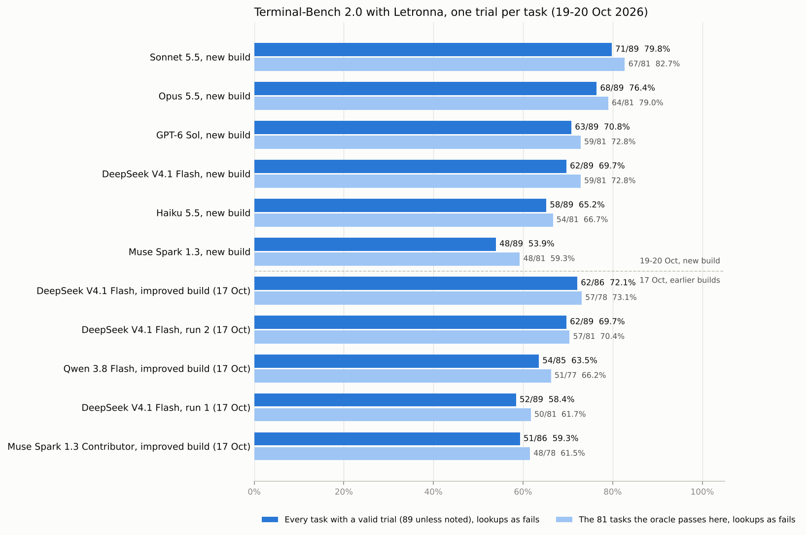
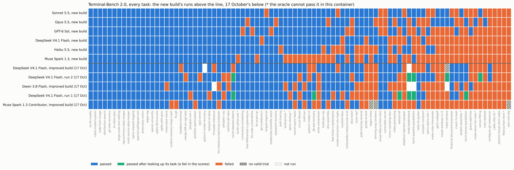

# Terminal-Bench 2.0, 19–20 October 2026

All 89 tasks, one trial each, on Letronna's new build, with six models:
Sonnet 5.5, Opus 5.5, Haiku 5.5, GPT-6 Sol, DeepSeek V4.1 Flash and Muse
Spark 1.3. Same host and Harbor 0.24 setup as
[16–18 October](../2026-10-17/README.md), whose full runs are in the charts
and `tasks.csv` for comparison. The three Claude models were reached through
the Anthropic API, the other three through the same gateway as before, all at
high reasoning. Every run has a valid trial for all 89 tasks.

Two more runs on the same build, GPT-6.1 Sol and Grok 4.7, were still going
when this was written; they will be added when they finish.

## The build

The new build is the improved build of 16–18 October plus eleven changes
that came out of reading its failures. Each is now merged:

- the reply after one stopped for thinking goes on from that thinking at low
  effort, told what stopped it (#741), where the improved build dropped the
  reasoning and asked again;
- a timed run's long command hands the turn back at half the time left, or as
  soon as a notice waits (#743);
- a run nobody watches tries a program that may change an input on a copy
  first (#737), which cost three models db-wal-recovery on 17 October;
- a run nobody watches asks again for a reply that loops on the same few
  words or stays empty (#739);
- a run that changed its checklist since it was sent back for open items is
  sent back again (#738);
- auto mode's judge waits up to a minute and may write 8,192 tokens in a run
  nobody watches (#736);
- a tool's result whose picture a request leaves out says so (#734);
- a call whose arguments end early says a special token written whole can end
  the output (#731);
- commands start with Ctrl-C and Ctrl-\ at their defaults, though Letronna was
  started ignoring them (#735);
- `run_command` says a command ran in the sandbox only when its result says
  so (#732), and `web_fetch` trusts the system's certificates as well as its
  own (#733).

Not in it: sending a run back once for a file its request names but it never
wrote (#740), and a check for a reply that only announces its next step.

The Claude, GPT-6 Sol and Muse runs used the same build with #744 on top (a
Custom endpoint that names the Messages route is spoken to as Anthropic),
which the Claude runs need; it changes nothing for a gateway that speaks the
Chat Completions format. The kit's metering, budget stop and reruns of trials
lost to the infrastructure are #742.

## Score

Lookups count as fails. The oracle cannot pass eight tasks in this container
(qemu-startup, qemu-alpine-ssh, caffe-cifar-10, filter-js-from-html,
make-doom-for-mips, protein-assembly, build-pmars and build-cython-ext), so
the fifth column leaves them out.

| Run | Tasks with a valid trial | Passed, as graded | Passed, lookups as fails | On the tasks the oracle passes here | Lookups |
|---|---|---|---|---|---|
| **Sonnet 5.5** | 89 | 71 (79.8%) | **71 (79.8%)** | **67/81 (82.7%)** | 0 |
| Opus 5.5 | 89 | 68 (76.4%) | 68 (76.4%) | 64/81 (79.0%) | 0 |
| GPT-6 Sol | 89 | 63 (70.8%) | 63 (70.8%) | 59/81 (72.8%) | 0 |
| DeepSeek V4.1 Flash | 89 | 62 (69.7%) | 62 (69.7%) | 59/81 (72.8%) | 0 |
| Haiku 5.5 | 89 | 58 (65.2%) | 58 (65.2%) | 54/81 (66.7%) | 0 |
| Muse Spark 1.3 | 89 | 48 (53.9%) | 48 (53.9%) | 48/81 (59.3%) | 0 |

No run looked up its own task. The lookup check flagged two trials of
mteb-leaderboard, Sonnet 5.5's pass and GPT-6 Sol's fail, for reaching
`mteb-leaderboard.hf.space` and its backend. That is the Scandinavian MTEB
leaderboard the task's instruction tells the model to use, not a copy of the
task, so neither counts as a lookup (`triage.txt` still lists the calls).
Counted the check's way, Sonnet 5.5 would be at 70.

Opus 5.5 lost nine tasks, Sonnet 5.5 three and Haiku 5.5 one to Anthropic's
content filter, each on its first reply or two, and GPT-6 Sol one to its
provider's filter ([below](#how-the-runs-went)); they count as fails.

Every task against every run, the new build's above the line and 16–18
October's full runs below it (blue passed, green passed after looking up its
own task, orange failed, hatched grey no valid trial, white not run):

Five tasks beat all six models: caffe-cifar-10 and filter-js-from-html (which
the oracle cannot pass here either), configure-git-webserver,
extract-moves-from-video and sam-cell-seg. 31 tasks passed on all six.

## DeepSeek V4.1 Flash: the new build against the improved build

On the same 86 tasks (those with a valid trial on the improved build):

| Same 86 tasks | Run 1 | Run 2 | Improved build | New build |
|---|---|---|---|---|
| Passed, as graded | 56 | 64 | 62 | 60 |
| Passed, lookups as fails | 51 | 61 | 62 | 60 |
| On the 78 the oracle passes here | 49 (62.8%) | 56 (71.8%) | 57 (73.1%) | 57 (73.1%) |
| Lookups | 5 | 3 | 0 | 0 |

The new build ties the improved build on the tasks the oracle passes; its two
fewer passes overall are protein-assembly and qemu-alpine-ssh, two of the
tasks the oracle cannot pass here, which the improved build passed. On all 89
it is 62, with two of the three large tasks the improved build never ran
(pytorch-model-recovery and mteb-leaderboard). The model was served by a
different provider this time (OpenCode Go rather than OpenRouter, below), so
part of any difference may be the provider's.

Gained (9): compile-compcert, count-dataset-tokens, db-wal-recovery,
headless-terminal, hf-model-inference, model-extraction-relu-logits,
pytorch-model-cli, regex-chess and winning-avg-corewars. Four of them are
losses the build set out to fix: compile-compcert and hf-model-inference had
lost their time to long foreground waits (#743), db-wal-recovery to a probe
that deleted the WAL it had to decode (#737), and regex-chess to 24 replies
cut for thinking (#741).

Lost (11): configure-git-webserver, crack-7z-hash, extract-elf,
financial-document-processor, git-multibranch, mcmc-sampling-stan,
overfull-hbox, protein-assembly, qemu-alpine-ssh, torch-tensor-parallelism and
video-processing. Nearly all read as the model's own work: a document filed on
the wrong side, a synonym the list does not allow, a weight split on the wrong
dimension, a takeoff frame 52 frames early, RStan never installed. One points
at the harness: in git-multibranch three replies thought for 101–207 s, were
cut, and nothing was written before the deadline.

The new build used fewer tokens: 1,126K a task with cache reads, against
1,928K for the improved build, at 11.8 minutes a task against 10.6.

## The models

Each folder's `failures.md` gives every failed trial's cause; the counts
below are of the 89 tasks.

### Sonnet 5.5

71 of 89 passed. Of the 18 failures, 7 were the model's own work, 4 are tasks
the oracle cannot pass here, 3 were stopped by the content filter, 2 were
verifier timeouts (query-optimize, torch-tensor-parallelism), 1 was
Letronna's guard (financial-document-processor, [below](#what-the-failures-say-about-letronna))
and 1 was YouTube refusing the download in extract-moves-from-video. It never
stopped at a deadline. 338K tokens and 5.2 minutes a task; $29.07 at list
price.

### Opus 5.5

68 of 89 passed, 68 of the 80 the content filter let run. Of the 21 failures,
9 were the filter (two of them, filter-js-from-html and protein-assembly, are
tasks the oracle cannot pass either), 6 the model's own work, 2 other tasks
the oracle cannot pass, 1 a verifier timeout, 1 Letronna's guard
(mteb-leaderboard), 1 YouTube (extract-moves-from-video) and 1 rstan-to-pystan,
which ended itself after the time warning with sampling at 45%. It used the
fewest tokens, 245K a task, at 5.7 minutes; $39.69 at list price.

### GPT-6 Sol

63 of 89 passed. Of the 26 failures, 20 were the model's own work, 4 are tasks
the oracle cannot pass here, 1 stopped at the deadline still trimming
gpt2-codegolf's source under its byte limit, and 1 was its provider's content
filter, which turned away every reply after round two of vulnerable-secret.
Four of the 20 ended when Letronna stopped a run going round in circles: it
sent `read_file` with no arguments again and again, sixteen times in one turn
of financial-document-processor. 339K tokens and 6.2 minutes a task.

### DeepSeek V4.1 Flash

62 of 89 passed. Of the 27 failures, 19 were the model's own work, 5 are tasks
the oracle cannot pass here, 2 stopped at the deadline (git-multibranch above,
and gpt2-codegolf, still reading the checkpoint format) and 1 was a verifier
timeout. It used the most tokens, 1,126K a task, and the most time, 11.8
minutes.

### Haiku 5.5

58 of 89 passed. Of the 31 failures, 24 were the model's own work, 3 are tasks
the oracle cannot pass here, 1 was the content filter (protein-assembly), 1 a
verifier timeout, 1 rstan-to-pystan (a second sampling run had just started
when the deadline came) and 1 Letronna's guard (build-pov-ray). It was the
fastest run, at 4.9 minutes a task, and cost $2.29 at list price.

### Muse Spark 1.3

48 of 89 passed. Of the 41 failures, 25 were the model's own work, 8 are the
tasks the oracle cannot pass here (it failed all eight), 5 stopped at the
deadline, 2 were verifier timeouts and 1 ended on a stream that broke off
(regex-chess, after one reply had thought for 1,034 s). Its pattern is the
same as the Contributor variant's on 17 October: 18 of its 41 failures ended
on a reply with no tool call, most of them an announced next step ("Found a
bit-order bug — fixing it and re-checking", "Rebooted — checking what the boot
screen shows"), and in three of its five deadline stops, replies cut for
thinking took the last minutes. 541K tokens and 10.5 minutes a task. This is
the muse-spark-1.3 model, not the Contributor variant of 16–18 October, so the
two are not the same run on two builds.

## What the failures say about Letronna

Read across the six runs, the failures point at these changes for the next
build. None is in this one.

- **Let the guard tell a task container from a user's files.** Once a run has
  read anything Letronna counts as untrusted (a web page, the task's own PDFs,
  a failed search's error page), its guard refuses commands that overwrite or
  delete files the session did not make, and tells the model "Do not look for
  another way to do it". The model obeys and stops. That cost three tasks
  outright: Sonnet 5.5's financial-document-processor, where moving the input
  files is the task; Opus 5.5's mteb-leaderboard, where the guard would not let
  it replace a placeholder in a file the session had itself made with `echo`;
  and Haiku 5.5's build-pov-ray, where it refused the `apt-get update` the
  oracle's own solution runs. It refused calls in six more failed trials
  without deciding them. The guard should count files made through the shell
  as the session's own, and in a run nobody watches inside a container it
  could allow package updates and moves of a task's inputs.
- **Take an announced next step for what it is.** Muse Spark 1.3 ended 18
  failed runs on a reply with no tool call, most of them saying what it would
  do next. The check designed for this after 17 October is not in this build.
- **Bound a reply's thinking by the time left.** Even with #741 carrying a cut
  reply's work on, strings of cut replies (60–123 s each) took the last minutes
  of three of Muse's five deadline stops, DeepSeek's git-multibranch wrote
  nothing after three, and one Muse reply in regex-chess thought for 1,034 s
  before it was cut.
- **Look into GPT-6 Sol's empty tool calls.** It sent calls with no
  arguments in 62 of the 264 replies where it batched several, and four of its
  runs ended on them. The review found nothing in Letronna's handling of the
  stream that would empty them, but they are worth checking against the
  provider's raw stream before blaming the model.
- **Send back a run whose required output is missing** (#740, merged after
  this build). In at least ten failed trials the run ended itself without
  writing the file the task asked for, most of them Muse's.

Several tasks failed the same way for every model, which reads as the task or
the host, not the harness: configure-git-webserver (the verifier pushes as
`git` with the password "password", which the instruction never gives),
extract-moves-from-video (YouTube asks this host to sign in, so no model got
the video), adaptive-rejection-sampler (a function signature the instruction
never gives) and sam-cell-seg (most runs lost it to the command-line flags or
the coordinate format the verifier expects).

## Other harnesses on the same models

Only Sonnet 5.5 has published Terminal-Bench 2.0 figures from other harnesses
on the same model: the [Theseus](https://github.com/zeroaltitude/theseus)
harness's authors ran it at high effort on 18 October, 89 tasks with three
trials each on Harbor 0.23, and report Claude Code 75.3%, Theseus 73.0%,
OpenCode 70.8% and Pi 70.4% (their own runs, with spend and turn caps on the
other harnesses). Letronna's 79.8% here is one trial per task, so it is not a
like-for-like lead: it is in the same range or a little above, within what one
trial per task can tell. The official
Terminal-Bench 2.0 board stopped taking entries before these models came out.

## How the runs went

- **The Claude key ran out of credit at 17:19 UTC on 19 October.** The trials
  that hit Anthropic's "credit balance is too low" were set aside as
  infrastructure, and run again once a second key came. Sonnet 5.5's
  compile-compcert, which lost four trials to the infrastructure, was rerun
  on its own.
- **Anthropic's content filter stopped replies outright** on nine Opus 5.5
  tasks (break-filter-js-from-html, crack-7z-hash, dna-assembly, dna-insert,
  feal-differential-cryptanalysis, filter-js-from-html, password-recovery,
  protein-assembly and vulnerable-secret), three Sonnet 5.5 tasks
  (break-filter-js-from-html, crack-7z-hash and vulnerable-secret) and one
  Haiku 5.5 task (protein-assembly). Each ended on its first reply or two;
  they count as fails. GPT-6 Sol's provider turned away every reply after
  round two of vulnerable-secret until the deadline.
- **The gateway's subscription routes have usage limits.** After about two and
  a half hours of three jobs on it, OpenCode Go began answering almost every
  call with "no lender was eligible", and the Muse provider's accounts went
  into cooldowns. From then on each provider carried one job, two trials at a
  time; a job paused itself when nearly every call for 15 minutes was turned
  away, and the trials an outage cut short were set aside and run again.
- **DeepSeek V4.1 Flash ran on two providers.** It started on OpenRouter,
  which turned the key away on price, and its 87 tasks ran through OpenCode
  Go. When OpenCode Go turned every call away on 20 October, its two mteb
  tasks ran through OpenRouter on another key.
- **The large tasks ran one at a time, outside the main jobs.** Their images
  (6–9 GB compressed) were pulled ahead of each trial, and the mteb ones need
  about 21 GB free during the pull, so the other runs paused for them.
  Once an image was removed from under a running trial (Muse Spark 1.3's
  mteb-leaderboard); that trial was set aside and the task run again.
- **The host's container restarted once**, at about 03:00 UTC on 20 October;
  the runs were started again from where they stopped.
- Up to about eight trials shared the host's 4 CPUs at once (three a run for
  the Claude models, two or three for the others), more than on 16–18 October.
- **Spend.** The Claude runs, at list price by the relay's meter: Sonnet 5.5
  $29.07, Opus 5.5 $39.69, Haiku 5.5 $2.29. The gateway's subscription routes
  charged a few percent of list price per call (about 4% for GPT-6 Sol and 1%
  for Muse Spark 1.3 and DeepSeek V4.1 Flash, measured per call), and all the
  gateway runs together, GPT-6.1 Sol and Grok 4.7 included, had come to under
  $9 by the meter when this was written.

## Read with care

- One trial per task. A task or two either way is noise.
- The Claude models were reached directly and the others through a gateway's
  subscription routes, on different providers; a provider can change a score.
- Nine of Opus 5.5's failures, three of Sonnet 5.5's and one each of Haiku
  5.5's and GPT-6 Sol's are the provider's filter, not the model's work.
- The container has 4 CPUs and no KVM, and more trials shared it than in the
  earlier runs, which weighs on tasks with a tight deadline.

## Files

- `scores.md`: the score table.
- `tasks.csv`: every task against every run, 16–18 October's full runs
  included: pass, pass-lookup, fail, no-valid-trial, or empty for not run.
- One folder per model with `summary.md` and `per-task.csv` (each task's
  reward, tokens and minutes, from `scripts/harbor/tb2/report.py`),
  `triage.txt` (each failed trial's error, result line and failed tests, from
  `triage.py`), and `failures.md` (why each failed trial lost its points).
