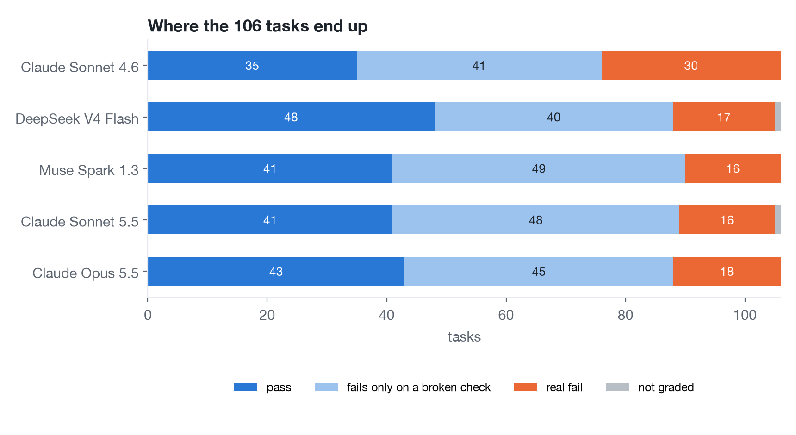
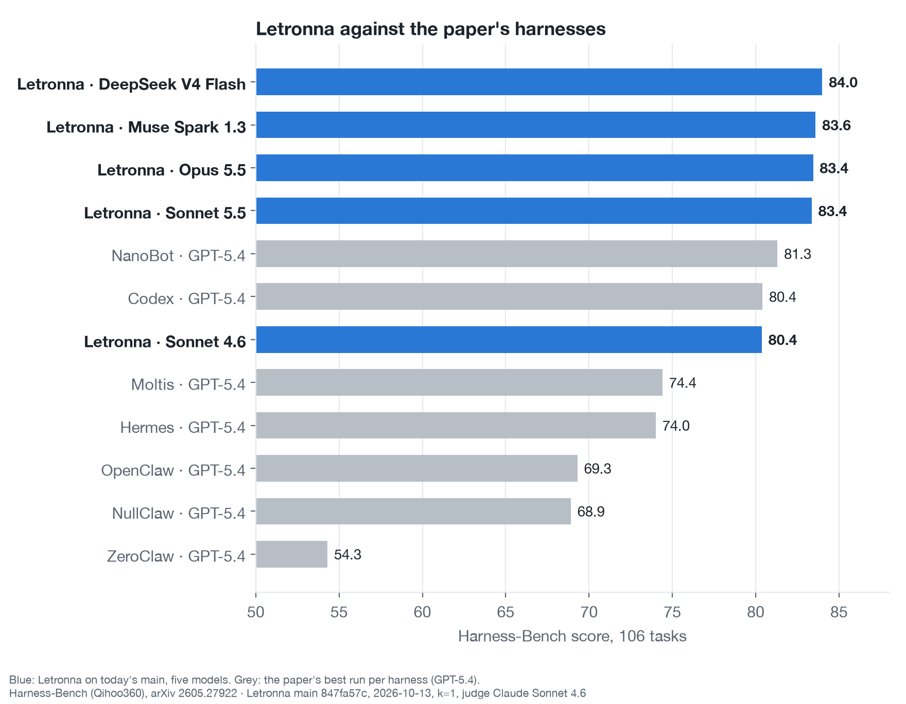
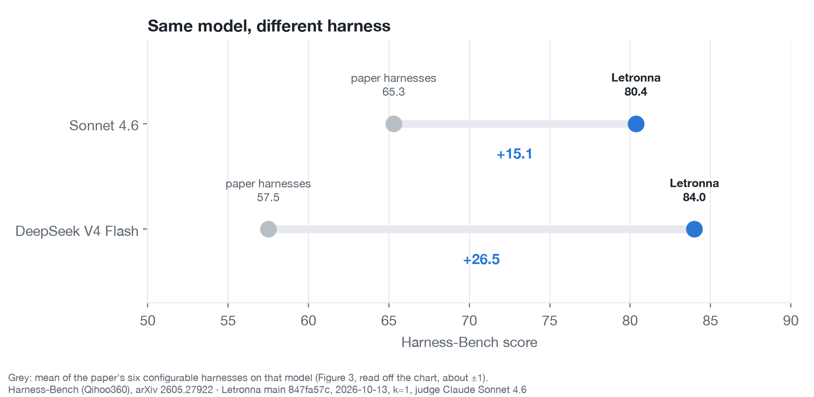
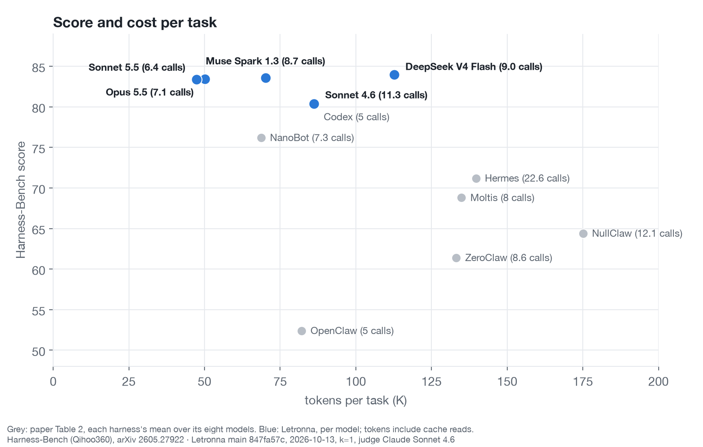
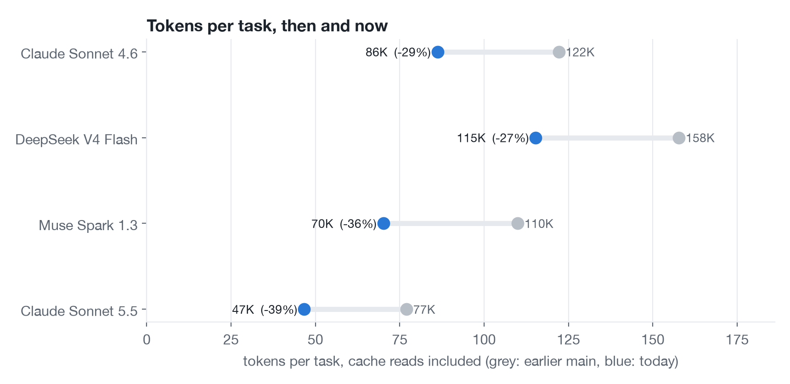

# Benchmarks

The full write-up, with a task explorer and the raw data, is at [letronna.ai/benchmark](https://letronna.ai/benchmark).

## Speed

These are the figures in `bench/baseline.json`. They were measured with a release build on a Mac mini M4 (16 GB, macOS 26.2), and each is the median of 7 runs. Lower is better.

| Metric | Result |
|---|---|
| Cold start to a ready prompt (500 sessions on disk) | 7.65 ms |
| Memory at idle (RSS) | 9.52 MB |
| List 500 sessions | 1.47 ms |
| List 5,000 sessions (~90 MB on disk) | 16.0 ms |
| Full-text search, 5,000 sessions | 102 ms |
| Open a 10,000-message session | 11.8 ms |
| Fit a 200k-token window over it | 0.52 ms |
| Parse a 10,000-event stream | 13.2 ms |

## Harness-Bench

[Harness-Bench](https://github.com/Qihoo360/harness-bench) ([paper](https://arxiv.org/abs/2605.27922)) has 106 agent tasks. Each is scored 0–100 by an outcome oracle, a security gate and an LLM judge. The latest run used Letronna main at `847fa57c` on 13 October 2026: every task once per model, five models one after another, judged by Claude Sonnet 4.6, with web search available through the gateway.

| Model | Score | Passed | Fails only on a broken check | Real fails | Tokens per task | Calls per task |
|---|---|---|---|---|---|---|
| DeepSeek V4 Flash | 84.0 | 48 | 40 | 17 | 113K | 9.0 |
| Muse Spark 1.3 | 83.6 | 41 | 49 | 16 | 70K | 8.7 |
| Claude Opus 5.5 | 83.4 | 43 | 45 | 18 | 50K | 7.1 |
| Claude Sonnet 5.5 | 83.4 | 41 | 48 | 16 | 47K | 6.4 |
| Claude Sonnet 4.6 | 80.4 | 35 | 41 | 30 | 86K | 11.3 |

The score is the mean over the graded tasks (105 or 106 per model). A task passes when every oracle check passes. "Fails only on a broken check" means each check it failed is one [`bench/harness-bench/known_issues.json`](../bench/harness-bench/known_issues.json) records as rejecting correct answers, with the proof; those tasks are kept out of tuning. Tokens include cache reads. Web search was used twice in 530 runs, as the tasks work on local files.

### Against the paper's harnesses

The paper's best configurations, on GPT-5.4, are NanoBot (81.3), Codex (80.4), Moltis (74.4), Hermes (74.0), OpenClaw (69.3), NullClaw (68.9) and ZeroClaw (54.3).

For the two models the paper also ran, only the harness differs:

| Model | Paper's six harnesses, mean | Letronna | Gain |
|---|---|---|---|
| DeepSeek V4 Flash | 57.5 | 84.0 | +26.5 |
| Claude Sonnet 4.6 | 65.3 | 80.4 | +15.1 |

The paper's per-model means are read off its Figure 3 (about ±1 point), and its Table 2 gives the harness means over eight models used in the last chart. The comparison is not like for like: the paper ran its harnesses on its own models, mostly GPT-5.4, which Letronna has not been run on; this run's judge is Claude Sonnet 4.6 with one run per model, so gaps of 1–3 points are within noise; and the paper may count tokens without cache reads.

### Against Letronna's earlier runs

On the tasks graded in both runs:

| Model | Earlier run | Tasks | Score | Passed | Tokens per task |
|---|---|---|---|---|---|
| DeepSeek V4 Flash | main `0bc18970`, 7 Oct | 94 | 84.2 → 83.9 | 40 → 43 | 158K → 115K |
| Muse Spark 1.3 | main `0eb48ad7`, 8 Oct | 106 | 83.0 → 83.6 | 39 → 41 | 110K → 70K |
| Claude Sonnet 5.5 | main `857311a3`, 8 Oct | 100 | 82.8 → 83.4 | 40 → 38 | 77K → 47K |
| Claude Sonnet 4.6 | main `0bc18970`, 6 Oct | 106 | 81.2 → 80.4 | 30 → 35 | 122K → 86K |

Scores held level while tokens per task fell by 27–39%, mostly from sending rare tools on demand and shorter tool descriptions.

### Raw data

[`bench/harness-bench/results/2026-10-13/`](../bench/harness-bench/results/2026-10-13/) holds the per-model summary, every task's result on every model (status, score, tokens, calls, web searches and the checks that failed for real), the paper's numbers beside Letronna's, and all of it as JSON.
